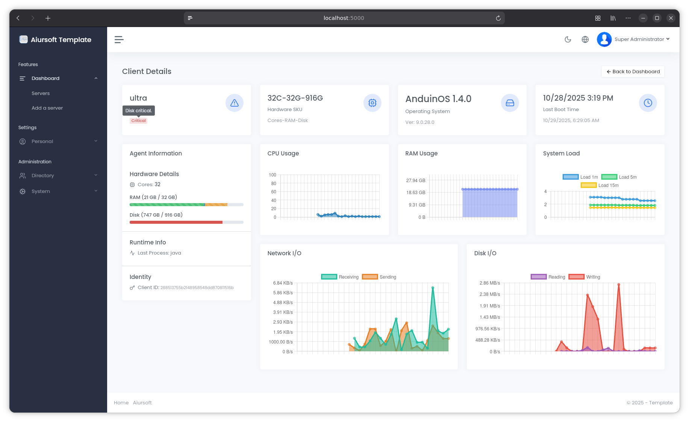

# StatHub

[](https://github.com/aiursoftweb/statHub/blob/master/LICENSE)
[](https://gitlab.aiursoft.com/aiursoft/statHub/-/pipelines)
[](https://gitlab.aiursoft.com/aiursoft/statHub/-/pipelines)
[](https://s360.aiursoft.com/SupplyChain?tab=projects&project=aiursoft%2Fstathub&scope=baseline&ecosystem=all)
[](https://manhours.aiursoft.com/r/github.com/aiursoftweb/statHub.html)
[](https://statHub.aiursoft.com)
[](https://hub.docker.com/r/aiursoft/stathub)

StatHub is a simple server stat statistics system. It can collect server stats and display them in a simple way.

Export raw server samples to ClickHouse in efficient five-minute batches with the Aiursoft ClickHouse SDK.
Build fleet overviews and compare individual servers in Grafana: [Build Dashboard](https://stathub.aiursoft.com/Home/BuildDashboard).

## CLI & SDK

Install the CLI with the [.NET 10 SDK](https://dotnet.microsoft.com/download/dotnet/10.0):

```bash
dotnet tool install --global Aiursoft.StatHub.Client --add-source https://nuget.aiursoft.com/v3/index.json
```

Run `stathub-client --help` to explore commands.

Add the SDK to your .NET project:

```bash
dotnet add package Aiursoft.StatHub.SDK --source https://nuget.aiursoft.com/v3/index.json
```



Default user name is `admin@default.com` and default password is `Admin@123456!`.

## Historical metrics

Enable `MetricsExport:Enabled` and set `MetricsExport:ConnectionString` to archive raw metrics every five minutes using Aiursoft.ClickhouseSdk. Query `ServerMetricsLatest` for deduplicated samples; retention defaults to 30 days. The bounded memory buffer retries failed writes, but unflushed samples are lost on restart or rejected when full. New clients send sampling timestamps; older clients are marked with receipt timestamps (`HasSampleTime = 0`).

## Try

Try a running StatHub [here](https://statHub.aiursoft.com).

## Install with Docker

Run the installer with the desired port (omit it to choose an available port):

```bash
curl -fsSL https://raw.githubusercontent.com/aiursoftweb/stathub/master/install.sh | sudo bash -s -- 8080
```

Installation starts after three seconds; press Ctrl+C to cancel. Then open `http://localhost:8080`.

## Run manually

Requirements about how to run

1. Install [.NET 10 SDK](http://dot.net/) and [Node.js](https://nodejs.org/).
2. Execute `npm install` at `wwwroot` folder to install the dependencies.
3. Execute `dotnet run` to run the app.
4. Use your browser to view [http://localhost:5000](http://localhost:5000).

## Run in Microsoft Visual Studio

1. Open the `.sln` file in the project path.
2. Press `F5` to run the app.

## Run in Docker

First, install Docker [here](https://docs.docker.com/get-docker/).

Then run the following commands in a Linux shell:

```bash
image=aiursoft/stathub
appName=stathub
sudo docker pull $image
sudo docker run -d --name $appName --restart unless-stopped -p 5000:5000 -v /var/www/$appName:/data $image
```

That will start a web server at `http://localhost:5000` and you can test the app.

The docker image has the following context:

| Properties  | Value                  |
|-------------|------------------------|
| Image       | aiursoft/stathub       |
| Ports       | 5000                   |
| Binary path | /app                   |
| Data path   | /data                  |
| Config path | /data/appsettings.json |

## How to contribute

There are many ways to contribute to the project: logging bugs, submitting pull requests, reporting issues, and creating suggestions.

Even if you with push rights on the repository, you should create a personal fork and create feature branches there when you need them. This keeps the main repository clean and your workflow cruft out of sight.

We're also interested in your feedback on the future of this project. You can submit a suggestion or feature request through the issue tracker. To make this process more effective, we're asking that these include more information to help define them more clearly.

## AlertCenter monitoring

Users with **Manage AlertCenter integration** permission can configure sustained health rules and server selection at `/AlertMonitoring`. Monitoring defaults to all known and future reporting servers with no exclusions. Exclusions override inclusions. The default rules are yellow or worse for 45/100 minutes, red or worse for 35/70 minutes, and grey for 25/40 minutes, each escalating from sev3 to sev2. Zero minutes means immediate; rules can be changed, disabled or deleted without being recreated at restart.

A valid green sample immediately resolves this integration's active incidents for that server by default; this behavior can be disabled. A new color resets its continuous timer. Existing incidents are escalated rather than duplicated and are never automatically downgraded. Grey starts one minute after the last valid report. Restart interrupts unobserved yellow/red continuity; the persisted last-report time still detects offline servers.

Configure the endpoint, secret application key and this StatHub instance's public base URL in Global Settings, then enable synchronization. The key needs query, create, resolve and change-severity scopes. Environment variables `GlobalSettings__AlertCenter_Enabled`, `GlobalSettings__AlertCenter_Endpoint`, `GlobalSettings__AlertCenter_ApiKey` and `GlobalSettings__AlertCenter_PublicBaseUrl` override the same settings. Synchronization is disabled until configured.
